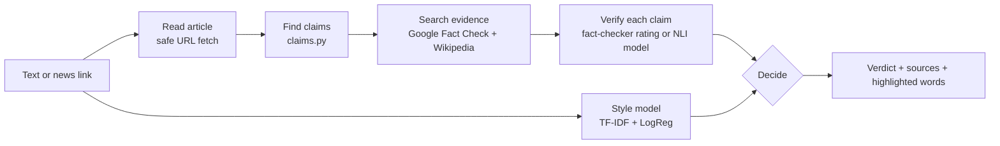

# Fake News Checker v2: style model + evidence-based fact-checking

A web app that checks news in two ways:

1. **Facts:** it finds the claims in the text, searches trusted sources (Google Fact Check API, Wikipedia) and uses an **NLI model** to decide whether the evidence **supports** or **refutes** each claim.
2. **Writing style:** a TF-IDF + Logistic Regression model trained on **~29,000 real fact-checked claims and headlines** gives a style score, with the words that pushed the decision.

Evidence always wins over style. When no evidence is found, the app says so clearly instead of pretending to know.


*Example result: a calm, well-written false claim. Style alone is unsure (52%), but the evidence decides.*

---

## Why v2? The problem with v1

Version 1 (kept in [`legacy/`](legacy/)) learned **how** fake news is written: shocking words, CAPS, "!!!".
That fails in two ways, and both are now **measured**, not guessed.

**1. It does not transfer to new sources.** Train on one dataset and test on another (macro-F1, 0.5 = guessing):

| trained on \ tested on | LIAR | PolitiFact | GossipCop |
|---|---|---|---|
| LIAR | **0.606** | 0.499 | 0.421 |
| PolitiFact | 0.511 | **0.822** | 0.451 |
| GossipCop | 0.446 | 0.535 | **0.761** |

Good on its own data (bold), close to random everywhere else.

**2. A calm, well-written lie passes.** On 25 calm sentences (15 false, 10 true, no sensational words) the style model gets **52%**, a coin flip. It caught only 5 of 15 lies.
See [`reports/well_written_lies_style.md`](reports/well_written_lies_style.md).

**The fix:** check the **facts**, not only the style. "The Eiffel Tower is in Rome" is written perfectly, but Wikipedia says *Paris*, and the NLI model marks that as a contradiction.

---

## How it works



| Step | File | What it does |
|---|---|---|
| Clean text | `fakenews/preprocess.py` | One cleaning function shared by training and the app (keeps "not", "never") |
| Style model | `fakenews/style_model.py` | Probability of fake + exact word contributions (weight × tf-idf) |
| Find claims | `fakenews/factcheck/claims.py` | Picks factual sentences (names, numbers; skips questions and opinions) |
| Evidence | `fakenews/factcheck/retrieve.py` | Google Fact Check Tools API + Wikipedia; a failing source never crashes the app |
| Verify | `fakenews/factcheck/verify.py` | Fact-checker rating → verdict, or NLI model `DeBERTa-v3-base-mnli-fever-anli` |
| Decide | `fakenews/pipeline.py` | Refuted → *Likely fake*; all supported → *Likely real*; else *Unverified* + style guess |
| Read links | `fakenews/article.py` | Extracts article text; blocks private/local addresses (SSRF protection) |
| Web app | `app/main.py` | FastAPI: `/api/check`, `/api/feedback`, `/api/model-info`, docs at `/docs` |

---

## Results

**Style model, trained on all three datasets** ([full report](reports/results.md)):

| test set | accuracy | macro-F1 | ROC-AUC |
|---|---|---|---|
| LIAR (short political claims) | 0.563 | 0.563 | 0.612 |
| PolitiFact headlines | 0.628 | 0.627 | 0.736 |
| GossipCop headlines | 0.820 | 0.761 | 0.855 |

LIAR is known to be very hard for text-only models, because the claims are short and calm. That is the reason for the evidence step.

**DistilBERT vs TF-IDF** (same splits): run [`notebooks/01_distilbert_training.ipynb`](notebooks/01_distilbert_training.ipynb) in Colab, which writes `reports/transformer_results.json`.

**Full checker on real fact-checked claims**: run [`notebooks/02_factcheck_evaluation.ipynb`](notebooks/02_factcheck_evaluation.ipynb). It reports *coverage* (how often evidence was found) and *accuracy when evidence decided*.

---

## Run it

```bash
git clone https://github.com/gunasekharkaranam/FAKE_NEWS_PPOC.git
cd FAKE_NEWS_PPOC
pip install -r requirements.txt            # light mode
# pip install -r requirements-ml.txt       # + NLI model (needs ~1.5 GB RAM)
cp .env.example .env                        # optional: add a Google Fact Check API key
uvicorn app.main:app --reload               # open http://127.0.0.1:8000
```

```bash
python -m scripts.train_style_model          # download data, retrain, write reports/
python -m scripts.well_written_lie_test      # the calm-lie test
pytest -q                                    # 26 tests, no internet needed
```

Docker (full version with NLI): `docker build -t fakenews . && docker run -p 7860:7860 fakenews`

Deploy: see [`docs/DEPLOY.md`](docs/DEPLOY.md) (Hugging Face Spaces for the full version, Render for light mode).

---

## Project structure

```
app/                 FastAPI app + page (templates/, static/)
fakenews/            the core library
  preprocess.py      shared text cleaning
  data.py            LIAR + FakeNewsNet download and loading (1 = fake, 0 = real)
  style_model.py     TF-IDF + Logistic Regression with explanations
  factcheck/         claims.py, retrieve.py, verify.py
  pipeline.py        combines everything
  article.py         safe link reading
  feedback.py        "was this correct?" storage (SQLite)
scripts/             training and evaluation scripts
notebooks/           Colab notebooks (DistilBERT, fact-check evaluation) + the old notebook
models/              trained style model
reports/             all results (generated by the scripts)
tests/               pytest tests (models and network are mocked)
docs/                learning guide, interview notes, deployment
legacy/              version 1 (Flask app) + Assignment0
```

## Data

| Dataset | What | Size used | Labels |
|---|---|---|---|
| [LIAR](https://aclanthology.org/P17-2067/) | Political claims rated by PolitiFact | 12,836 | pants-fire / false / barely-true → fake; half-true / mostly-true / true → real |
| [FakeNewsNet](https://github.com/KaiDMML/FakeNewsNet) PolitiFact | News headlines | 979 | fake / real |
| FakeNewsNet GossipCop | Entertainment headlines | 20,700 | fake / real |

Data is downloaded by `fakenews/data.py` and not stored in the repo.

## Limitations (honest list)

- **Very new news** may not have evidence online yet. The app then says *Unverified* instead of guessing.
- Evidence is only as good as the sources. Wikipedia is general knowledge, so local or very recent claims need the fact-check API or a news API.
- The style model picks up **topic bias**: words like "obama" and "trump" lean fake because of what the fact-checkers chose to check. That is one more reason it is not used as the final judge.
- NLI can be fooled by evidence about a slightly different event, so every verdict shows its sources for the user to check.

## Version 1 → 2 changes

- Fixed: Real/Fake labels were **swapped** in the v1 app.
- Fixed: training and app cleaned text differently; regex typo `\@w+`.
- Fixed: v1 was trained on a 7,613-tweet Kaggle `train.csv` with `keyword`/`location`/`target` columns, which matches the *NLP with Disaster Tweets* dataset, so it was likely detecting disaster tweets, not fake news.
- Added: real-world data, cross-dataset tests, fact-checking, confidence, explanations, link input, feedback, API, tests, CI, Docker.
